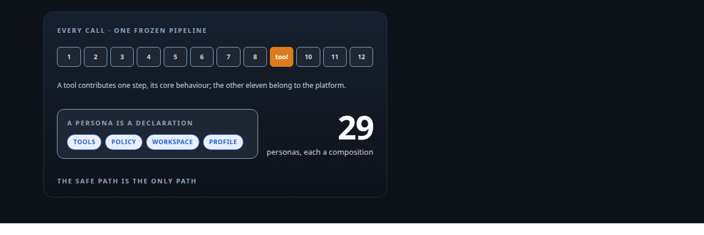
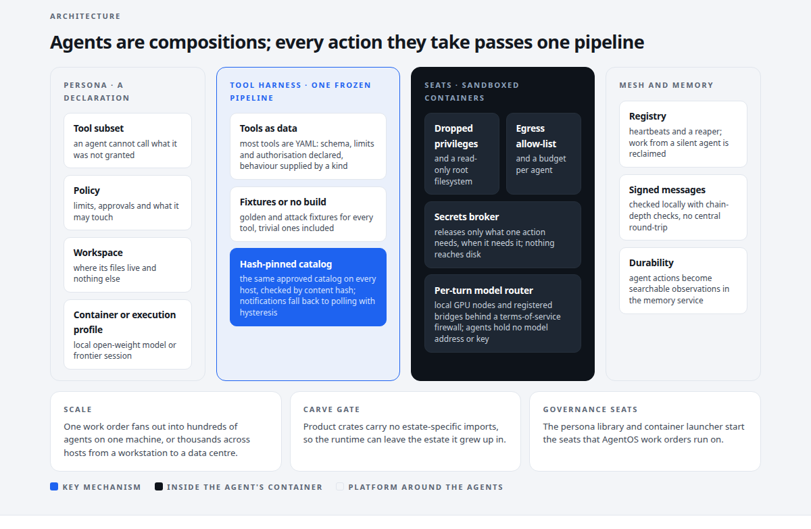
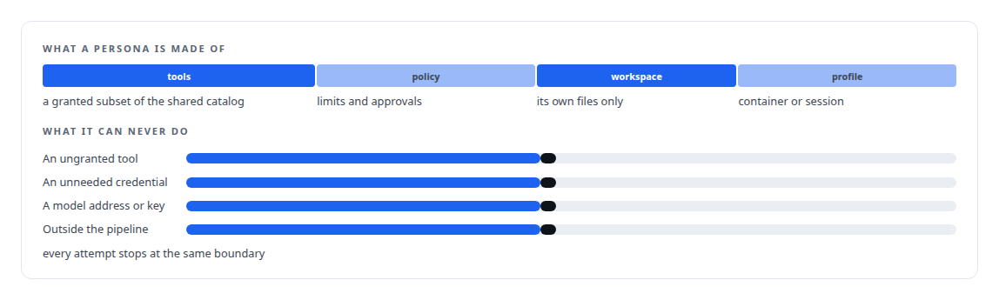
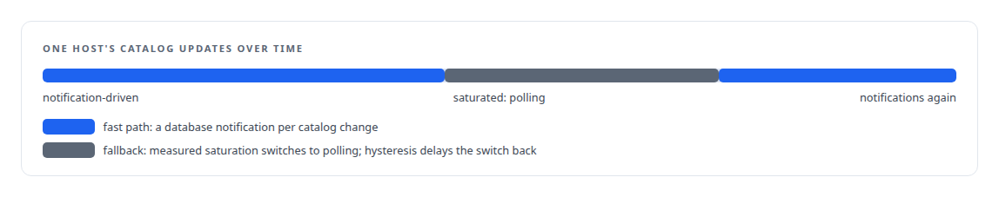
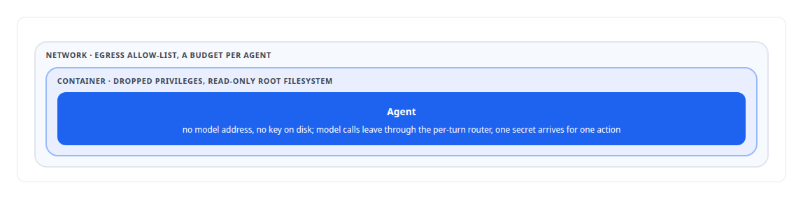
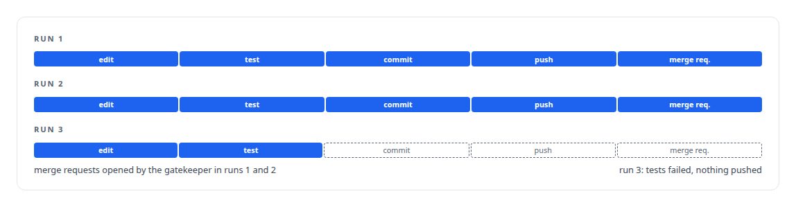

# Agent Swarm

**A self-hosted, multi-host runtime where tools are the platform and agents are compositions**

Canonical: https://coreyjames.ai/systems/agent-swarm/  
Author: Corey James · Published: 2026-10-28 · Kind: system  
Technologies: [ACME](https://github.com/coreyjames-ai/portfolio/tree/main/technologies/acme) · [Agent Client Protocol (ACP)](https://github.com/coreyjames-ai/portfolio/tree/main/technologies/agent-client-protocol-acp) · [Agent tool qualification testing](https://github.com/coreyjames-ai/portfolio/tree/main/technologies/agent-tool-qualification-testing) · [Agent tool-execution safety and sandboxing](https://github.com/coreyjames-ai/portfolio/tree/main/technologies/agent-tool-execution-safety-and-sandboxing) · [Applied cryptography](https://github.com/coreyjames-ai/portfolio/tree/main/technologies/applied-cryptography) · [Axum](https://github.com/coreyjames-ai/portfolio/tree/main/technologies/axum) · [Bash](https://github.com/coreyjames-ai/portfolio/tree/main/technologies/bash) · [Budget enforcement and cost governance](https://github.com/coreyjames-ai/portfolio/tree/main/technologies/budget-enforcement-and-cost-governance) · [Cargo](https://github.com/coreyjames-ai/portfolio/tree/main/technologies/cargo) · [Catalog versioning and drift detection](https://github.com/coreyjames-ai/portfolio/tree/main/technologies/catalog-versioning-and-drift-detection) · [Credential brokering and secrets management](https://github.com/coreyjames-ai/portfolio/tree/main/technologies/credential-brokering-and-secrets-management) · [Declarative tool and agent definition](https://github.com/coreyjames-ai/portfolio/tree/main/technologies/declarative-tool-and-agent-definition) · [Distributed-systems reliability](https://github.com/coreyjames-ai/portfolio/tree/main/technologies/distributed-systems-reliability) · [Docker](https://github.com/coreyjames-ai/portfolio/tree/main/technologies/docker) · [Federated compute provisioning](https://github.com/coreyjames-ai/portfolio/tree/main/technologies/federated-compute-provisioning) · [Git](https://github.com/coreyjames-ai/portfolio/tree/main/technologies/git) · [GitLab](https://github.com/coreyjames-ai/portfolio/tree/main/technologies/gitlab) · [Governed AI-assisted software engineering](https://github.com/coreyjames-ai/portfolio/tree/main/technologies/governed-ai-assisted-software-engineering) · [Idempotency, exactly-once effects and crash recovery](https://github.com/coreyjames-ai/portfolio/tree/main/technologies/idempotency-exactly-once-effects-and-crash-recovery) · [JSON Schema](https://github.com/coreyjames-ai/portfolio/tree/main/technologies/json-schema) · [JSON Web Token (JWT)](https://github.com/coreyjames-ai/portfolio/tree/main/technologies/json-web-token-jwt) · [JSON-RPC](https://github.com/coreyjames-ai/portfolio/tree/main/technologies/json-rpc) · [Linux security primitives](https://github.com/coreyjames-ai/portfolio/tree/main/technologies/linux-security-primitives) · [MessagePack](https://github.com/coreyjames-ai/portfolio/tree/main/technologies/messagepack) · [Model Context Protocol (MCP)](https://github.com/coreyjames-ai/portfolio/tree/main/technologies/model-context-protocol-mcp) · [Multi-agent system architecture and orchestration](https://github.com/coreyjames-ai/portfolio/tree/main/technologies/multi-agent-system-architecture-and-orchestration) · [OpenAI-compatible API](https://github.com/coreyjames-ai/portfolio/tree/main/technologies/openai-compatible-api) · [PostgreSQL](https://github.com/coreyjames-ai/portfolio/tree/main/technologies/postgresql) · [Provider-terms compliance in model routing](https://github.com/coreyjames-ai/portfolio/tree/main/technologies/provider-terms-compliance-in-model-routing) · [Redis](https://github.com/coreyjames-ai/portfolio/tree/main/technologies/redis) · [Rust](https://github.com/coreyjames-ai/portfolio/tree/main/technologies/rust) · [SQL](https://github.com/coreyjames-ai/portfolio/tree/main/technologies/sql) · [Static analysis as tests](https://github.com/coreyjames-ai/portfolio/tree/main/technologies/static-analysis-as-tests) · [TLS and mTLS](https://github.com/coreyjames-ai/portfolio/tree/main/technologies/tls-and-mtls) · [Tokio](https://github.com/coreyjames-ai/portfolio/tree/main/technologies/tokio) · [Vendor-integration reverse engineering](https://github.com/coreyjames-ai/portfolio/tree/main/technologies/vendor-integration-reverse-engineering) · [YAML](https://github.com/coreyjames-ai/portfolio/tree/main/technologies/yaml) · [sqlx](https://github.com/coreyjames-ai/portfolio/tree/main/technologies/sqlx) · [tmux](https://github.com/coreyjames-ai/portfolio/tree/main/technologies/tmux) · [vLLM](https://github.com/coreyjames-ai/portfolio/tree/main/technologies/vllm)  
Skills: [agent orchestration](https://github.com/coreyjames-ai/portfolio/tree/main/skills/agent-orchestration) · [sandboxing and container hardening](https://github.com/coreyjames-ai/portfolio/tree/main/skills/sandboxing-and-container-hardening) · [distributed systems correctness](https://github.com/coreyjames-ai/portfolio/tree/main/skills/distributed-systems-correctness) · [multi-agent governance](https://github.com/coreyjames-ai/portfolio/tree/main/skills/multi-agent-governance)  



## Result

| Figure | What it measures |
| --- | --- |
| **12** | steps every tool call passes through, in a frozen order |
| **40** | declarative tools, none without golden and attack fixtures |
| **0** | commits to the main repository across three coding-agent runs on a local model |
| **60+** | locked decisions in a 2,000-line master plan |



## What was built

Every new agent an organisation adds tends to arrive with its own tooling, its own permissions and its own messaging, and every one of those is a new place for something to go wrong. I wanted to build the safety machinery once, make it the only path, and make adding an agent a matter of declaring one. Agent Swarm is that runtime. Tools are the platform: every action any agent takes passes through one frozen, tested pipeline. The runtime runs coding, analysis and service agents on local open-source models and on frontier models, spans more than one machine, and its persona library and container launcher start the seats of my governance platform.

## The idea

Validation, authorisation, rate limits, quotas, retries, sanitisation, audit and observation happen in the same order for every call, and that order cannot change without sign-off. A tool contributes only its core behaviour. Most tools are YAML declarations. No tool enters the catalog without golden fixtures and attack fixtures, and the build fails otherwise. The full account is [Tools are the platform](https://coreyjames.ai/stories/tools-are-the-platform).


Agents are compositions. A persona is a tool subset, a policy, a workspace and a container or execution profile, and a new one is a declaration. An agent cannot call what it was not granted and never holds a credential it does not need.



## What I built

An agentic loop over a provider-neutral model layer with an endpoint pool and a terms-of-service firewall that decides which traffic may reach which provider. The loop pattern was adapted from an open-source project.

An agent registry with heartbeats, a reaper and drift detection, plus signed agent-to-agent messaging with chain-depth checks, so agents find and call one another and every message is attributable.

A persona launcher that starts sandboxed containers per persona with scoped tokens, workspaces and budgets.

Cross-host federation, and a durability path that turns agent actions into searchable observations in my memory service.

Hash-pinned tool catalogs with drift detection: every host runs the same approved catalog, checked by content hash, with notification-driven updates that fall back to polling under measured saturation thresholds and hysteresis so a host never flaps.



A carve gate that keeps product crates free of estate-specific imports, so the runtime is separable from the estate it grew up in.

The launcher alone is about 23,000 lines, and the catalog carries 50 golden fixtures.

## Across hosts

One work order can fan out into hundreds of agents on one machine or thousands across hosts I control, from a workstation to a data centre, coordinated over a signed agent-to-agent mesh in which every message is checked locally for sub-millisecond peer authorisation with no central round-trip. Each agent heartbeats its presence to the registry, and in-flight work from an agent that stops heartbeating is reclaimed automatically. Agents never hold a model address or key; the runtime proxies every model call through a per-turn router over local GPU nodes and registered bridges. Secrets never touch disk: a broker releases only what a specific action needs, when it needs it.



## The judgment in it

I left one tool kind declared but not runnable instead of releasing it with the pipeline partly bypassed.

I required fixtures for trivial tools, because exceptions are where the holes are.

For the coding agent's acceptance runs I chose a narrow scripted task over an impressive demo, so the security property got tested instead of the model's cleverness. A failing-test run that stopped without pushing counted as a pass. The runs are told in [A coding agent that never holds the keys](https://coreyjames.ai/stories/a-coding-agent-that-never-holds-the-keys).



I held a phase at conditional pass on two failed gates instead of narrowing the criteria, and had the missing tooling built afterwards.

## What it demonstrates

Making the safe path the only path for agent actions; defence-in-depth sandboxing; reliability engineering for distributed configuration; and least-privilege design for autonomous coding agents, proven on a local model.

## Stories

[Tools are the platform](https://coreyjames.ai/stories/tools-are-the-platform) · [A coding agent that never holds the keys](https://coreyjames.ai/stories/a-coding-agent-that-never-holds-the-keys) · [Separation of duties for AI work](https://coreyjames.ai/stories/separation-of-duties-for-ai-work)

## Technologies

Rust · Tokio · Docker · Redis Streams · PostgreSQL · YAML tool definitions · JSON Schema · RS256-signed envelopes · Open-weight local models on vLLM · Content hashing

> I froze the pipeline order. Less flexibility, and exactly one way an action happens.

## What was verified

Each line is a claim the canonical page supports, with the figure as the page states it.

- Agent orchestration: a self-hosted multi-host agent runtime where every tool call passes one frozen pipeline of 12 steps, and a new agent persona is a declaration.
- Test-gated tool catalogs: 40 declarative tools, none without golden and attack fixtures, with 50 golden fixtures in the catalog and hash-pinned catalogs checked for drift on every host.
- Sandboxing and container hardening: a persona launcher of about 23,000 lines starting sandboxed containers with scoped tokens, workspaces and budgets; secrets released per action and never written to disk.
- Distributed agent messaging: signed agent-to-agent envelopes with chain-depth checks, checked locally for sub-millisecond peer authorisation, and heartbeats that reclaim work from a silent agent.
- Least-privilege design for autonomous coding agents: 0 commits to the main repository across three coding-agent runs on a local model.
- Architecture under written decisions: 60+ locked decisions in a 2,000-line master plan, and a carve gate that keeps product crates free of estate-specific imports.

## Related

- [Tools are the platform](https://github.com/coreyjames-ai/agent-swarm/tree/main/stories/tools-are-the-platform) · https://coreyjames.ai/stories/tools-are-the-platform/
- [A coding agent that never holds the keys](https://github.com/coreyjames-ai/agent-swarm/tree/main/stories/a-coding-agent-that-never-holds-the-keys) · https://coreyjames.ai/stories/a-coding-agent-that-never-holds-the-keys/
- [Separation of duties for AI work](https://github.com/coreyjames-ai/agentos/tree/main/stories/separation-of-duties-for-ai-work) · https://coreyjames.ai/stories/separation-of-duties-for-ai-work/
- [Directing AI coding agents at program scale](https://github.com/coreyjames-ai/agentos/tree/main/stories/directing-ai-coding-agents-at-program-scale) · https://coreyjames.ai/stories/directing-ai-coding-agents-at-program-scale/

## Skills demonstrated

Decided at build time against every page in this system, strongest first; each links to the page that earns it.

- [sandboxing and container hardening](https://github.com/coreyjames-ai/portfolio/tree/main/skills/sandboxing-and-container-hardening) · [A coding agent that never holds the keys](https://github.com/coreyjames-ai/agent-swarm/tree/main/stories/a-coding-agent-that-never-holds-the-keys)
- [agent orchestration](https://github.com/coreyjames-ai/portfolio/tree/main/skills/agent-orchestration) · [Agent Swarm](https://github.com/coreyjames-ai/agent-swarm)

## Engineering stories in Agent Swarm (2)

| Story | Result | Figure |
| --- | --- | --- |
| [Tools are the platform](stories/tools-are-the-platform) | One frozen, tested pipeline for every action an agent takes, and catalogs that cannot drift between hosts | 12 |
| [A coding agent that never holds the keys](stories/a-coding-agent-that-never-holds-the-keys) | A sandboxed agent on a local open-source model that edits, tests and proposes changes without a repository credential | 0 |

Part of [Corey James's portfolio](https://github.com/coreyjames-ai/portfolio): research, technologies, skills and the other systems. Canonical site: https://coreyjames.ai/

## Citation

Corey James. "Agent Swarm." coreyjames.ai, 2026. https://coreyjames.ai/systems/agent-swarm/

```bibtex
@misc{coreyjames-agent-swarm,
  author = {Corey James},
  title = {Agent Swarm},
  year = {2026},
  howpublished = {\url{https://coreyjames.ai/systems/agent-swarm/}},
  note = {GitHub copy: https://github.com/coreyjames-ai/agent-swarm}
}
```

Part of [Agent Swarm](https://github.com/coreyjames-ai/agent-swarm) and [Corey James's portfolio](https://github.com/coreyjames-ai/portfolio) · site: https://coreyjames.ai/ · MCP server: https://coreyjames.ai/mcp · agent card: https://coreyjames.ai/.well-known/agent.json
