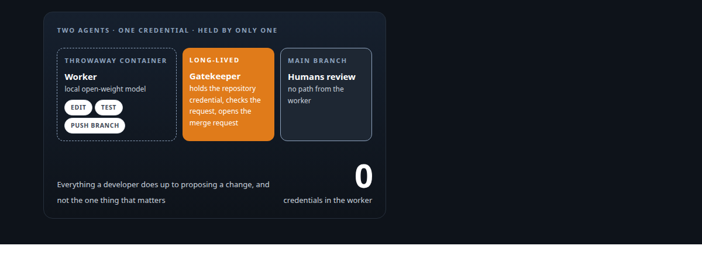
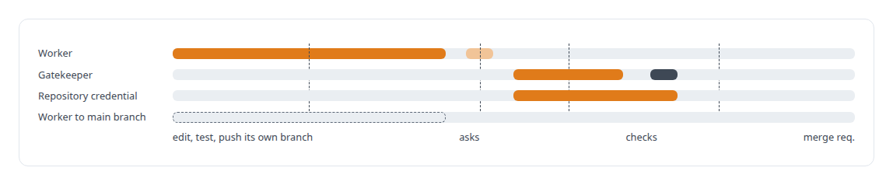
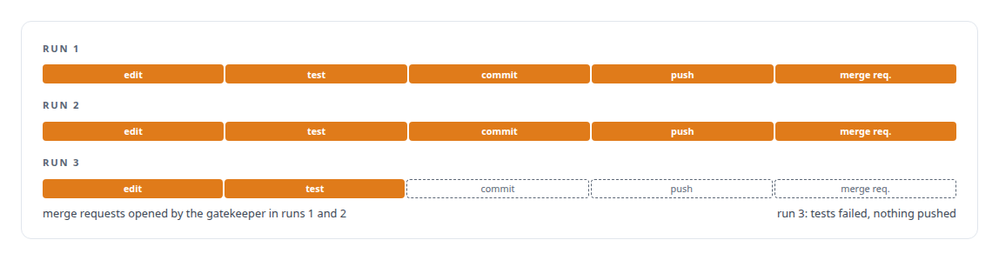

# A coding agent that never holds the keys

**A sandboxed agent on a local open-source model that edits, tests and proposes changes without a repository credential**

Canonical: https://coreyjames.ai/stories/a-coding-agent-that-never-holds-the-keys/  
Author: Corey James · Published: 2026-10-28 · Kind: story  
DOI: https://doi.org/10.5281/zenodo.23735118 (this page is a chapter of the system's report)  
Systems: [Agent Swarm](https://github.com/coreyjames-ai/agent-swarm)  
Technologies: [Agent Client Protocol (ACP)](https://github.com/coreyjames-ai/portfolio/tree/main/technologies/agent-client-protocol-acp) · [Agent tool-execution safety and sandboxing](https://github.com/coreyjames-ai/portfolio/tree/main/technologies/agent-tool-execution-safety-and-sandboxing) · [Credential brokering and secrets management](https://github.com/coreyjames-ai/portfolio/tree/main/technologies/credential-brokering-and-secrets-management) · [Docker](https://github.com/coreyjames-ai/portfolio/tree/main/technologies/docker) · [Git](https://github.com/coreyjames-ai/portfolio/tree/main/technologies/git) · [GitLab](https://github.com/coreyjames-ai/portfolio/tree/main/technologies/gitlab) · [Identity and access management for AI agents](https://github.com/coreyjames-ai/portfolio/tree/main/technologies/identity-and-access-management-for-ai-agents) · [JSON Web Token (JWT)](https://github.com/coreyjames-ai/portfolio/tree/main/technologies/json-web-token-jwt) · [Linux security primitives](https://github.com/coreyjames-ai/portfolio/tree/main/technologies/linux-security-primitives) · [Multi-agent system architecture and orchestration](https://github.com/coreyjames-ai/portfolio/tree/main/technologies/multi-agent-system-architecture-and-orchestration) · [OpenAI-compatible API](https://github.com/coreyjames-ai/portfolio/tree/main/technologies/openai-compatible-api) · [Redis](https://github.com/coreyjames-ai/portfolio/tree/main/technologies/redis) · [Rust](https://github.com/coreyjames-ai/portfolio/tree/main/technologies/rust) · [vLLM](https://github.com/coreyjames-ai/portfolio/tree/main/technologies/vllm)  
Skills: [sandboxing and container hardening](https://github.com/coreyjames-ai/portfolio/tree/main/skills/sandboxing-and-container-hardening) · [AI-assisted engineering methodology](https://github.com/coreyjames-ai/portfolio/tree/main/skills/ai-assisted-engineering-methodology) · [evidence-gated acceptance](https://github.com/coreyjames-ai/portfolio/tree/main/skills/evidence-gated-acceptance) · [multi-agent governance](https://github.com/coreyjames-ai/portfolio/tree/main/skills/multi-agent-governance)  



## Result

| Figure | What it measures |
| --- | --- |
| **0** | agent commits or merge requests against the main repository |
| **2** | full runs through edit, test, commit, push and merge request |
| **1** | failing-test run that stopped without pushing, scored as a pass |

## What was built

A coding agent running on a local open-source model edited code in a throwaway container, ran the tests, committed, pushed, and a merge request appeared for human review. The agent never held the repository credential and had no path to the main branch. A second, long-lived agent checked the request and opened the merge request on its behalf.

## The challenge

Autonomous coding agents are useful in proportion to what they can touch, and dangerous in the same proportion. The usual compromise hands the agent a scoped token and hopes. I wanted a design where the worker could do everything a developer does up to the point of proposing a change, and could not do the one thing that matters: write to the repository everyone depends on.

## Constraints

A local open-weight model served through vLLM on my own hardware, with no frontier API in the loop. A throwaway container, destroyed after the run. Humans review every change.

## My approach

Split the job. The worker agent edits, tests and pushes to its own branch. A separate gatekeeper agent, long-lived, checks the worker's request and opens the merge request. The worker never holds the repository credential.



## What I built

Coder and gatekeeper personas with distinct tool grants.

A path by which the worker asks the gatekeeper to act on a finished branch.

## Difficult decisions

A narrow scripted task for acceptance.


The acceptance task was small and exact, so the security property got tested instead of the model's cleverness.

Counting a failing-test run as a success. One run's tests failed. The agent stopped without pushing. That is the correct behaviour and it was scored as a pass.

## Results

Acceptance runs on an internal test repository:



## Technologies used

Rust · Docker · Redis Streams · Open-weight local models on vLLM · GitLab API

## What this demonstrates

Least-privilege design for autonomous coding agents, proven with an honest scope, on a local model.

> An impressive open-ended demo would have proved less.

## What was verified

Each line is a claim the canonical page supports, with the figure as the page states it.

- Least-privilege design for autonomous coding agents: a worker on a local open-weight model edits, tests and pushes its own branch with no repository credential; 0 commits or merge requests against the main repository.
- Sandboxing and container hardening: the worker runs in a throwaway container destroyed after the run, on a model served through vLLM on my own hardware.
- Gatekeeper pattern for AI agents: a separate long-lived agent holds the credential, checks the worker's request and opens the merge request for human review, across 2 full runs.
- Honest acceptance testing for AI agents: 1 failing-test run that stopped without pushing was scored as a pass, because the security property was what the test measured.

## Related

- [Tools are the platform](https://github.com/coreyjames-ai/agent-swarm/tree/main/stories/tools-are-the-platform) · https://coreyjames.ai/stories/tools-are-the-platform/
- [Separation of duties for AI work](https://github.com/coreyjames-ai/agentos/tree/main/stories/separation-of-duties-for-ai-work) · https://coreyjames.ai/stories/separation-of-duties-for-ai-work/

## Citation

Corey James. "A coding agent that never holds the keys." coreyjames.ai, 2026. https://coreyjames.ai/stories/a-coding-agent-that-never-holds-the-keys/ In: the Agent Swarm technical report, doi:10.5281/zenodo.23735118.

```bibtex
@misc{coreyjames-a-coding-agent-that-never-holds-the-keys,
  author = {Corey James},
  title = {A coding agent that never holds the keys},
  year = {2026},
  howpublished = {\url{https://coreyjames.ai/stories/a-coding-agent-that-never-holds-the-keys/}},
  note = {GitHub copy: https://github.com/coreyjames-ai/agent-swarm/tree/main/stories/a-coding-agent-that-never-holds-the-keys},
  doi = {10.5281/zenodo.23735118}
}
```

Part of [Agent Swarm](https://github.com/coreyjames-ai/agent-swarm) and [Corey James's portfolio](https://github.com/coreyjames-ai/portfolio) · site: https://coreyjames.ai/ · MCP server: https://coreyjames.ai/mcp · agent card: https://coreyjames.ai/.well-known/agent.json
