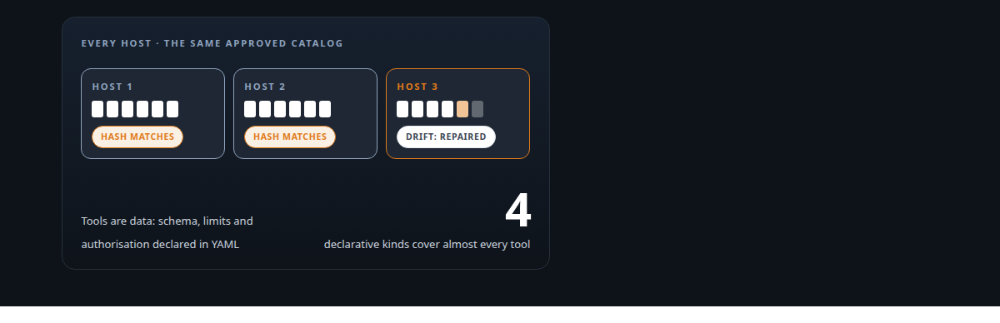
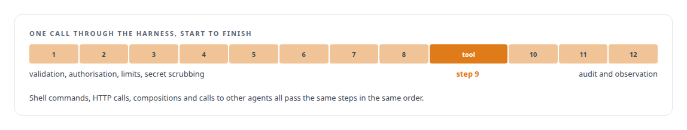
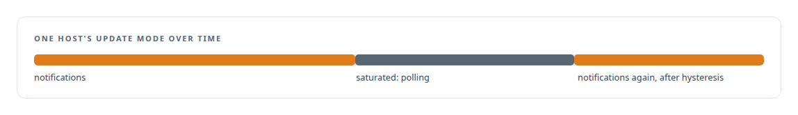

# Tools are the platform

**One frozen, tested pipeline for every action an agent takes, and catalogs that cannot drift between hosts**

Canonical: https://coreyjames.ai/stories/tools-are-the-platform/  
Author: Corey James · Published: 2026-10-28 · Kind: story  
Systems: [Agent Swarm](https://github.com/coreyjames-ai/agent-swarm)  
Technologies: [Agent tool qualification testing](https://github.com/coreyjames-ai/portfolio/tree/main/technologies/agent-tool-qualification-testing) · [Agent tool-execution safety and sandboxing](https://github.com/coreyjames-ai/portfolio/tree/main/technologies/agent-tool-execution-safety-and-sandboxing) · [Catalog versioning and drift detection](https://github.com/coreyjames-ai/portfolio/tree/main/technologies/catalog-versioning-and-drift-detection) · [Declarative tool and agent definition](https://github.com/coreyjames-ai/portfolio/tree/main/technologies/declarative-tool-and-agent-definition) · [JSON Schema](https://github.com/coreyjames-ai/portfolio/tree/main/technologies/json-schema) · [Multi-agent system architecture and orchestration](https://github.com/coreyjames-ai/portfolio/tree/main/technologies/multi-agent-system-architecture-and-orchestration) · [PostgreSQL](https://github.com/coreyjames-ai/portfolio/tree/main/technologies/postgresql) · [Provider-terms compliance in model routing](https://github.com/coreyjames-ai/portfolio/tree/main/technologies/provider-terms-compliance-in-model-routing) · [Redis](https://github.com/coreyjames-ai/portfolio/tree/main/technologies/redis) · [Rust](https://github.com/coreyjames-ai/portfolio/tree/main/technologies/rust) · [Static analysis as tests](https://github.com/coreyjames-ai/portfolio/tree/main/technologies/static-analysis-as-tests) · [Tokio](https://github.com/coreyjames-ai/portfolio/tree/main/technologies/tokio) · [YAML](https://github.com/coreyjames-ai/portfolio/tree/main/technologies/yaml)  
Skills: [distributed systems correctness](https://github.com/coreyjames-ai/portfolio/tree/main/skills/distributed-systems-correctness) · [tool synthesis and governed API integration](https://github.com/coreyjames-ai/portfolio/tree/main/skills/tool-synthesis-and-governed-api-integration) · [AI-assisted engineering methodology](https://github.com/coreyjames-ai/portfolio/tree/main/skills/ai-assisted-engineering-methodology)  



## Result

| Figure | What it measures |
| --- | --- |
| **12** | pipeline steps on every call, in an order frozen behind sign-off |
| **40** | declarative tools, plus Rust built-ins |
| **50** | golden fixtures; a tool without its fixtures fails the build |

## What was built

An agent that acts on real systems needs validation, authorisation, limits, secret scrubbing, audit and observation on every action. If each tool implements those itself, every new tool is a new hole. In my agent runtime every call, whatever the tool, passes through one frozen, ordered pipeline of twelve steps, and a tool contributes only its core behaviour. Most tools are declared in YAML. No tool enters the catalog without golden fixtures and attack fixtures, and the build fails if one is missing.

## The challenge

Tools come in many kinds: shell commands, HTTP calls, compositions of other tools, calls to other agents. Local open-source models make malformed calls. Adding a tool has to stay cheap or the estate stops growing. And every host in the fleet has to run the same approved catalog, which is harder than it sounds when the change notification path can back up under load and a host that misses a change keeps running stale tools.

## Constraints

One path, no exceptions: a tool kind that bypassed the pipeline would be the hole. Cheap to add, impossible to add badly. Catalog consistency across hosts without missing changes and without flapping between update modes.

## My approach

Freeze the pipeline. Every call passes the same twelve steps in the same order, and that order cannot change without sign-off. Tools are data wherever they can be, declared in YAML with their schema, limits and authorisation. For catalog consistency, each catalog has a deterministic hash, hosts detect drift through database notifications, and when notifications saturate they fall back to polling with measured thresholds and hysteresis so a host does not oscillate.

## What I built

A Rust tool harness with the twelve-step pipeline, and four declarative tool kinds that cover almost everything an agent does.



A test runner that fails the build for any tool without golden fixtures, and injection fixtures for the shell template kind.

Hash-pinned catalogs with hot reload, and a drift detector with saturation thresholds and hysteresis.

Least-privilege tool access: an agent cannot call what it was not granted.

## Difficult decisions

Freezing the order. A fixed pipeline is less flexible than a configurable one. It is also something you can trust, because there is exactly one way an action happens.

Leaving a kind declared but not runnable. One extension tool kind was designed and not finished. I left it declared and non-runnable instead of releasing it half-done with the pipeline partly bypassed.

Fixtures for trivial tools. A one-line tool still needs its golden and attack fixtures.


Explicit thresholds over "just poll". Measured saturation thresholds with a fallback and hysteresis keep notification-driven updates fast when they work and stable when they do not.



## Results

The frozen pipeline is used by every agent launched in the acceptance runs, including the local-model coding runs.

## Technologies used

Rust · Tokio · YAML tool definitions · JSON Schema · PostgreSQL LISTEN/NOTIFY · Redis · Content hashing · Fixture-driven test runners

## What this demonstrates

Making the safe path the only path for agent actions, and reliability engineering for distributed configuration: the same catalog on every host, checked by hash, updated without missing a change or flapping.

> Exceptions are where the holes are.

## What was verified

Each line is a claim the canonical page supports, with the figure as the page states it.

- Agent tool execution safety: every agent call passes one frozen pipeline of 12 steps covering validation, authorisation, limits, secret scrubbing, audit and observation; a tool supplies only its own behaviour.
- Declarative tool design: 40 declarative tools in YAML carrying their schema, limits and authorisation, plus Rust built-ins.
- Test-gated tool catalogs: 50 golden fixtures plus attack fixtures and shell-injection fixtures; a tool without its fixtures fails the build.
- Distributed configuration consistency: hash-pinned tool catalogs with drift detection over database notifications, falling back to polling under measured saturation thresholds with hysteresis.
- Least privilege for AI agents: an agent can call only the tools its persona was given.

## Related

- [A coding agent that never holds the keys](https://github.com/coreyjames-ai/agent-swarm/tree/main/stories/a-coding-agent-that-never-holds-the-keys) · https://coreyjames.ai/stories/a-coding-agent-that-never-holds-the-keys/
- [Tools that build tools, under governance](https://github.com/coreyjames-ai/fafo-core/tree/main/stories/tools-that-build-tools-under-governance) · https://coreyjames.ai/stories/tools-that-build-tools-under-governance/

## Citation

Corey James. "Tools are the platform." coreyjames.ai, 2026. https://coreyjames.ai/stories/tools-are-the-platform/

```bibtex
@misc{coreyjames-tools-are-the-platform,
  author = {Corey James},
  title = {Tools are the platform},
  year = {2026},
  howpublished = {\url{https://coreyjames.ai/stories/tools-are-the-platform/}},
  note = {GitHub copy: https://github.com/coreyjames-ai/agent-swarm/tree/main/stories/tools-are-the-platform}
}
```

Part of [Agent Swarm](https://github.com/coreyjames-ai/agent-swarm) and [Corey James's portfolio](https://github.com/coreyjames-ai/portfolio) · site: https://coreyjames.ai/ · MCP server: https://coreyjames.ai/mcp · agent card: https://coreyjames.ai/.well-known/agent.json
